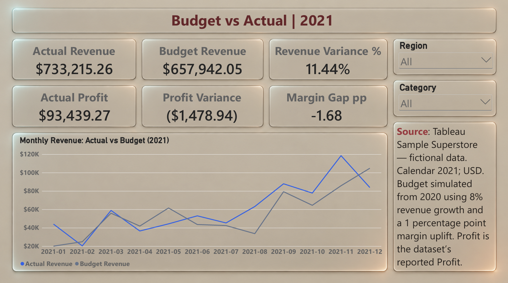
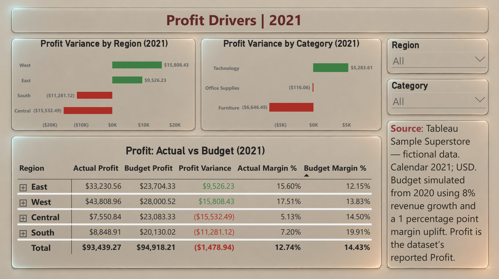
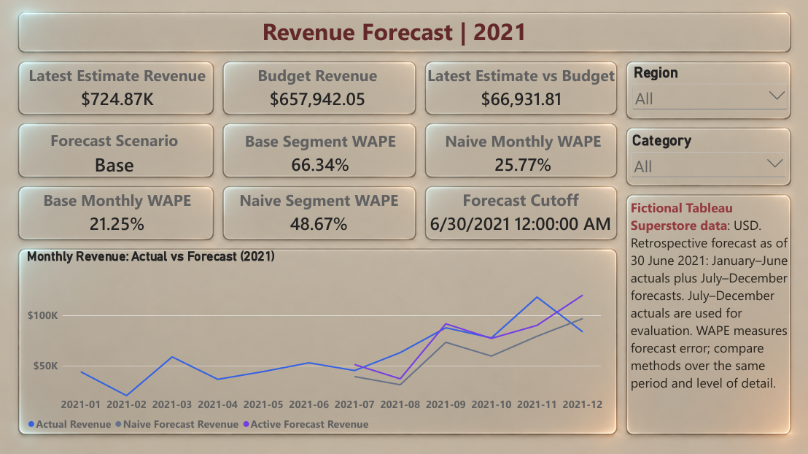

# Retail Budget vs Actual & Revenue Forecast

An Excel and Power BI portfolio project that compares 2021 retail performance with a simulated budget, explains regional and category profit variances, and evaluates two revenue forecasting methods.

**Data:** Tableau Sample Superstore, a fictional retail dataset. **Currency:** USD. **Budget:** simulated from 2020 actuals. **Forecast:** a retrospective exercise with a 30 June 2021 cutoff.

## Report

[View the three-page report PDF](docs/Retail_Budget_Actual_Forecast_2021.pdf)

### Budget vs Actual

### Profit Drivers

### Revenue Forecast

The PDF and images are static previews. Open the PBIX file to use the Region and Category slicers and expand the Region-to-Category matrix.

## Business questions

- Did revenue and reported profit meet the simulated budget?
- Which regions and categories contributed the largest profit variances?
- What full-year revenue would have been estimated at 30 June 2021?
- Does a forecast that works at company level also work at segment level?

## Key findings

1. **Revenue exceeded budget, while reported profit fell short.** Revenue was $733,215.26, or 11.44% above budget. Reported profit was $93,439.27, which was $1,478.94 below budget. The actual margin was 12.74% against a 14.43% budget margin.
2. **Regional results offset one another.** West exceeded its profit budget by $15,808.43 and East by $9,526.23. Central missed by $15,532.49 and South by $11,281.12.
3. **Furniture had the largest category profit shortfall:** $6,646.49 below budget. This identifies a priority for further product and pricing analysis; it does not establish the cause of the shortfall.
4. **Forecast performance depended on the level of aggregation.** The Base method reduced company-month WAPE, but the seasonal-naive method performed better at the month-region-category level.

### Full-year budget comparison

| Metric | 2021 result |
|---|---:|
| Actual revenue | $733,215.26 |
| Budget revenue | $657,942.05 |
| Revenue variance | +$75,273.21 |
| Revenue variance % | +11.44% |
| Actual reported profit | $93,439.27 |
| Budget reported profit | $94,918.21 |
| Profit variance | -$1,478.94 |
| Actual margin | 12.74% |
| Budget margin | 14.43% |
| Margin gap | -1.68 percentage points |

The margin gap is calculated from unrounded margins before display rounding.

### Forecast evaluation: July-December 2021

| Evaluation level | Seasonal naive WAPE | Base WAPE |
|---|---:|---:|
| Month x Region x Category: 72 observations | 48.67% | 66.34% |
| Company monthly totals: 6 observations | 25.77% | 21.25% |

Lower WAPE means less error over the same evaluation window and level of detail. Segment errors can offset when aggregated, so the better company-level result does not imply better segment forecasts. WAPE is an error measure; `1 - WAPE` is not presented as forecast accuracy.

The Base full-year latest estimate was **$724,873.85**, consisting of January-June actual revenue plus the July-December Base forecast. It was **$66,931.81 above the simulated budget**. The report abbreviates the latest-estimate card as `$724.87K`.

## Methods and assumptions

### Budget

- Baseline: calendar 2020.
- Budget year: calendar 2021.
- Revenue growth assumption: 8% for each Region-Category segment.
- Target margin: the segment's 2020 reported-profit margin plus 1 percentage point.
- Monthly phasing: the segment's 2020 revenue seasonality.
- The fixed comparison baseline is stored as frozen `Budget_v1` values.

### Forecast

- Cutoff: 30 June 2021; January-June 2021 actuals are available to the model.
- Seasonal naive: the corresponding 2020 month, Region and Category revenue.
- Base: seasonal-naive revenue adjusted by that segment's first-half year-over-year revenue growth factor.
- Downside and Upside: 95% and 105% of the Base second-half forecast. These are sensitivity cases, not confidence intervals.
- July-December 2021 actuals are reserved for evaluation, not used as forecast drivers.

Power BI imports the saved Excel scenario. The scenario card displays that case; it is not a live scenario selector. The supplied report uses **Base**. WAPE cards compare the Naive and Base methods, independently of the selected sensitivity case.

## Tools and model

- **Excel:** data preparation, assumptions, simulated budget, forecast scenarios and checks.
- **Power Query:** import and transformation of workbook tables.
- **Power BI and DAX:** model relationships, measures, filtering, conditional formatting and report visuals.

The monthly model has three fact tables (`FactActualMonthly`, `FactBudgetMonthly`, `FactForecastMonthly`) and three shared dimensions (`DimMonth`, `DimRegion`, `DimCategory`). Each fact table contains 144 rows at Month x Region x Category level. The dimensions contain 12 months, 4 regions and 3 categories. Nine active many-to-one relationships connect facts to dimensions with single-direction filtering.

## Repository contents

| Location | Contents |
|---|---|
| `data/raw/` | Original `Sample - Superstore.xls` dataset |
| `data/processed/` | Location reserved for optional prepared-data exports; Power BI reads the Excel workbook directly |
| `excel/Retail_Budget_Actual_2021.xlsx` | Excel budget, forecast and validation workbook |
| `powerbi/Retail_Budget_Actual_2021.pbix` | Interactive Power BI report |
| `docs/Retail_Budget_Actual_Forecast_2021.pdf` | Static three-page report |
| `docs/screenshots/` | Three clean dashboard preview images |
| `docs/METHODOLOGY.md` | Calculations, data quality decisions, model design and validation scope |
| `docs/DAX_Measures.md` | The 23 DAX measure definitions |

## Open and refresh

1. Download the repository, keeping its folder structure.
2. Open `excel/Retail_Budget_Actual_2021.xlsx` in Excel. In `Controls!M2`, choose the desired case: `1` = Downside, `2` = Base, `3` = Upside. Recalculate and save the workbook.
3. Open `powerbi/Retail_Budget_Actual_2021.pbix` in Power BI Desktop.
4. Open **Transform data**, then use **Manage Parameters** in Power Query to update the existing `pWorkbook` parameter to the full path of your local Excel workbook. The path must be accessible from the environment running Power BI Desktop.
5. Select **Close & Apply**, then **Refresh**. Set Region and Category to All to reproduce the totals above.

The PBIX includes cached data for viewing. Refresh requires the local workbook path. Changing the Excel scenario requires recalculation, saving and a Power BI refresh.

## Validation and scope

The reviewed Excel workbook passed 25 checks. The three 144-row Power BI fact tables were reconciled to Excel by Month, Region and Category. The exported PDF was checked for all three report pages, displayed financial totals and the four WAPE results. The hidden Validation page remains in the PBIX for technical checks.

Profit refers to the source dataset's reported `Profit` field. The analysis does not establish it as gross, operating or net profit. The budget is a portfolio assumption, and the forecast is a retrospective backtest. Findings describe the fictional dataset and do not claim real-company impact.

## Sources and credits

- [Tableau: Superstore dataset context and sample-data download guidance](https://help.tableau.com/current/guides/get-started-tutorial/en-us/get-started-tutorial-connect.htm).
- [Microsoft: Power Query parameters](https://learn.microsoft.com/en-us/power-query/power-query-query-parameters).
- [Rob J Hyndman: WAPE definition and limitations](https://robjhyndman.com/hyndsight/wape.html).

Background artwork was generated with AI. Charts, cards, slicers, text and calculations are implemented in Excel and Power BI. Source data remains attributable to its original provider; no new license for the source dataset is asserted here.

**Author:** Tony Antony
